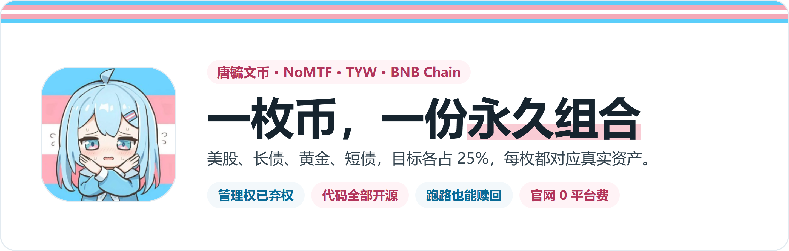

<p align="center"></p>

<p align="center">
  <a href="https://xyn.lgbt/">官网买卖</a> ·
  <a href="https://nomtf.github.io/NoMTF-TYW/">独立赎回</a> ·
  <a href="https://bscscan.com/token/0xaE7eA21fBf3613fFc17fe962EE66bfe03015fBa7#tokenAnalytics">链上持仓</a> ·
  <a href="SECURITY.md">合约权限</a>
</p>

# 唐毓文币 · TYW

**老唐的个人 meme 币，也是一份可以放进钱包的永久组合。**

每一份 TYW，都对应金库中同比例的真实资产。股票、长债、黄金、短债各有一席之地，代币净值随组合变化。买入建立持仓，赎回销毁份额，资产和代码都摆在链上。

> **金库管理权已弃权，项目方提不走金库里的用户储备。**
>
> 老唐可以停止维护网站，却不能收走你的合约赎回权。持有人可以自己按份额领取底层资产，无需项目方批准。[查看弃权交易](https://bscscan.com/tx/0xdd101a9ee5aaf9d932a063f09bfefbd2c43db08646f885c7b421a11d9a0d2676) · [独立赎回入口](https://nomtf.github.io/NoMTF-TYW/) · [权限与底层资产条件](SECURITY.md)

| 真实持仓 | 源码公开 | 管理权已弃权 | 自己赎回 |
| :--- | :--- | :--- | :--- |
| 资产实际到账后才能铸币，份额与储备相对应 | 合约、网站、报价与监控代码均可查看和复现 | 金库 owner 为零地址，没有项目方提取储备或升级合约的入口 | 不需要老唐批准；官网停运也能调用固定合约取回资产 |

## 它怎么运作

用 USDT 买入时，金库通过固定的底层交易池买入资产，再按实际到账资产铸造 TYW。卖出时销毁份额，将对应资产兑换为 USDT；也可以直接领取四项底层代币和金库中的现金。

官网钱包买卖无需 KYC，**平台费 0%**。底层兑换费和网络 gas 在确认前展示；费用明显变化时，可以查看最新预估后再决定是否继续。

四项资产的目标权重各为 25%。每小时检查一次，任意一项达到 15% 或 35% 才生成调仓方案，执行需要钱包签名。合约限制调仓路径、损耗及调仓后的权重。

## 金库里有什么

| 资产 | 对应部分 | 目标权重 |
| :--- | :--- | ---: |
| SPYB | 股票 | 25% |
| TLTon | 长期国债 | 25% |
| XAUm | 黄金 | 25% |
| SGOVon | 短期国债 | 25% |

网页占比读取真实持仓和链上估值，展示的是当时的组合。每份代币代表同样比例的这四项资产，跟踪的是这份组合的净值。

## 老唐跑路了，怎么赎回

**赎回用不着老唐点头。**

持有人可以直接调用固定金库的 `redeemInKind(uint256,uint256[4],uint256)`，按份额领取底层代币及现金。这条路径不依赖官网 API、报价预言机、兑换池或运维机器人，普通交易暂停时也保留。

- [独立赎回页面](https://xyn.lgbt/exit.html)：完整单文件，可以下载保存。
- [GitHub Pages 备用入口](https://nomtf.github.io/NoMTF-TYW/)：与官网分开托管。
- [直接访问金库合约](https://bscscan.com/address/0xaE7eA21fBf3613fFc17fe962EE66bfe03015fBa7#writeContract)：连接自己的钱包签名。

管理员没有提取金库储备、无资产增发、任意外部调用、替换底层资产或升级金库的权限。池子中由庄家自有资金形成的 LP 是庄家的资产，与用户金库储备分开。具体权限和底层代币转账条件见 [SECURITY.md](SECURITY.md)。

金库管理权已于 **2026 年 10 月 11 日弃权**，`owner()` 与 `pendingOwner()` 均为零地址。买卖、转账、调仓及独立赎回继续按固定合约执行；暂停与恢复交易的管理开关永久取消。庄家钱包和 LP 归属保持不变。[查看弃权交易](https://bscscan.com/tx/0xdd101a9ee5aaf9d932a063f09bfefbd2c43db08646f885c7b421a11d9a0d2676) · [弃权后功能验证](reports/renounce-fork.json)

也可以用 Node 20+ 生成未签名的赎回交易数据，无需安装依赖：

```sh
node scripts/redeem-calldata.mjs 0x你的钱包地址 1
```

脚本只生成交易数据，不广播交易。下载的 HTML 可放在自己的静态站点或本地 HTTP 服务上使用；钱包通常不会向 `file://` 页面注入连接功能。

## 合约和代码

部署在 **BNB Chain，链 ID 56**。金库地址同时也是 TYW 代币地址。

| 合约 | BSC 地址 |
| :--- | :--- |
| TYW / 固定金库 | [`0xaE7eA21fBf3613fFc17fe962EE66bfe03015fBa7`](https://bscscan.com/address/0xaE7eA21fBf3613fFc17fe962EE66bfe03015fBa7) |
| 固定 TWAP 预言机 | `0x178436E1750Be2Bb1fff667245DF80c77D89Bb97` |
| 外部池费率 Hook | `0xC146249412d9eB47a5e6719b29fE37e443fB4870` |
| 配对入池合约 | `0x9722A21a3df964A4Dce56E23AfCaDc4A1080aCb0` |
| 单边自动配平合约 | `0x913591050C1f9047f4B825697D3A2302D7F82D8b` |
| LP 手续费收取合约 | `0x37f2964B322e014c8EA33D700bC94f28Fe7C9432` |

| 目录 | 内容 |
| :--- | :--- |
| [`deployments/source`](deployments/source) | **线上已部署金库与预言机的实际源码** |
| [`contracts`](contracts) | 入池合约及开发版本；其中开发金库与线上版本分开 |
| [`web`](web) / [`src`](src) | 网站、报价、钱包连接和 Worker |
| [`scripts`](scripts) / [`test`](test) | 构建、源码核对、独立赎回和测试 |
| [`reports`](reports) | 源码与运行时代码比对、依赖检查及本地分叉验证记录 |

已发布 Solidity 源码验证和运行时代码核对记录。公开源码方便任何人审阅，也欢迎独立审计和问题反馈。

## 自动补池

汇入原庄家账户 `0x9979Ba992c6aAf7cDd068A82d14F7Afa6c7f4cD1` 的 TYW 与 USDT，每五分钟检查一次。只有一边或两边不等时，通过原金库转换多余部分，再配平加入 [TYW / USDT 池](https://pancakeswap.finance/liquidity/pool/bsc/0xda9f38117db4572febb150af16c262e6f1b5f8f4502b0c3281a8215edfdb188b)。**新增 LP 始终归原庄家账户**，余款退回原账户。

自动执行先等钱包中可入池的两种资产按净值合计达到 **20 USDT**，再检查带余量的 gas 预算是否不超过本次价值的 **0.5%**；小额到账留在原账户累积。这个门槛用于补池，不限制用户的小额申购。

合约自身最低价值仍为 1.1 USDT，单轮上限 1,900 USDT；转换损耗和配平偏差分别限制在 0.5% 内。自动程序的金额与成本门槛更加严格，人工调用固定合约仍受原合约条件约束。成本或价格条件不合适时，资金留在原账户等下一轮。执行账户仅提供 gas，不持有用户储备。

庄家 LP 产生的手续费也按这五分钟一轮检查。固定收取合约只用零流动性变化领取手续费，不能提取 LP 本金，也不能转移 NFT；收款方始终是原庄家账户。只有可领手续费与钱包库存足以补池、且领取 gas 不超过这笔手续费价值的 0.5% 时才领取，之后由下一轮补池程序配平入池。金额太小时留在 LP 中积累。

外部池兑换采用约买入 +5%、卖出 −5% 的方向费率，另计适用的协议费用与 gas；官网直接申购赎回仍为平台费 0%。

[查看已完成的自动入池交易](https://bscscan.com/tx/0x3f9607cbbe1b98b9878c0023cbbc1d1fcb9074bc283135a20d13d1bee4ff9a3c) · [验证记录](reports/auto-liquidity-mainnet.json)

## 在本地跑起来

Node 20+：

```sh
npm ci
npm run dev
npm test
npm run build
```

安装 Anvil 后，可以在本地分叉链验证单边入池、LP 归属及停运赎回：

```sh
node --import tsx scripts/fork-auto-liquidity.mjs
```

测试只修改本地分叉。Windows 可使用随项目安装的可选 Anvil；其他系统安装 Anvil 到 PATH，或设置 `ANVIL_BIN`。需要时使用 `FORK_RPC_URL` 指定 RPC。

网站首屏和恢复代码内嵌在 HTML 中，资源失败会有限重试，历史构建资源保留 30 天。正在运行的交易页面不会被自动刷新。钱包支持已安装的 EVM 扩展、EIP-6963 发现、移动钱包入口及 WalletConnect 扫码连接。自行部署时，通过 Worker 的 `WALLETCONNECT_PROJECT_ID` 环境配置启用扫码入口；API 密钥不进入客户端。

钱包列表提供 21 个常用入口，包含 Keeper（原 Tonkeeper）；更多钱包通过 WalletConnect 选择支持 BNB Chain 的版本。可以直接连接，也可以一键打开官网 DApp 或带入币对与金额的 PancakeSwap 页面。Keeper 的手机签名尚未实机验证；同名旧 Waves Keeper 使用不同网络。OKX 交易所 App 与独立 OKX Wallet 分开提供入口。外部平台是否接受兑换路线，由其自身决定。

项目代码采用 MIT 许可证，依赖沿用各自许可证。头像素材的权利与软件许可证分开。私钥、助记词、运行日志和用户邮件不在公开仓库中。
